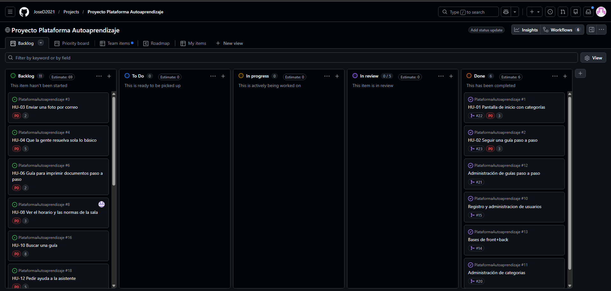
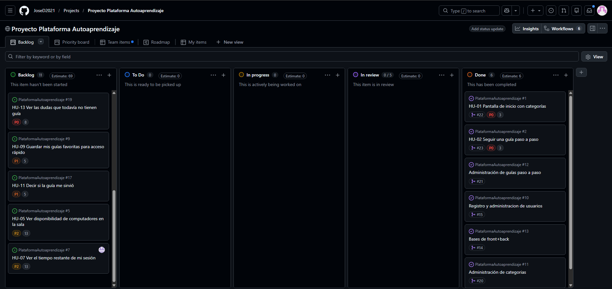

# Alianza con el equipo de Backend

## Backlog validado

Tablero de GitHub Projects del equipo de Backend con las 13 historias priorizadas y estimadas (7 de noviembre de 2026). En cada tarjeta se ve la prioridad y los puntos:

- **P0** = Debe tener
- **P1** = Debería tener
- **P2** = Podría tener

## Sprint Review

- **Fecha:** 7 de noviembre de 2026, 4:12 p. m. (Sprint Review 1)
- **Enlace a la grabación:** [Ver grabación](https://uninorte-my.sharepoint.com/personal/fernandezjose_uninorte_edu_co/_layouts/15/stream.aspx?id=%2Fpersonal%2Ffernandezjose%5Funinorte%5Fedu%5Fco%2FDocuments%2FGrabaciones%2FPlataforma%20de%20aprendizaje%20Sprint%20Review%201%2D20261107%5F161252%2DGrabaci%C3%B3n%20de%20la%20reuni%C3%B3n%2Emp4)
- **Acta:** [2026-11-07-sprint-review-1.md](actas/2026-11-07-sprint-review-1.md)
- **Retroalimentación dada:**
  - El incremento sigue el diseño del prototipo (colores y estructura), así que no se pidieron cambios de diseño.
  - Se propuso adelantar primero las historias que son guías paso a paso, por ser las más simples, antes del 10 de noviembre.
  - Se acordó la versión de administrador para la monitora de la sala, para modificar guías y ver las sugerencias y guías que hacen falta.

## Issues de feedback

Issues registrados con la etiqueta `feedback-cliente` (mínimo 5).

- _Enlace al Issue — historia revisada_

## Estado de avance de las historias «Debe tener»

| Historia | Estado |
|---|---|
| HU-01 Pantalla de inicio con categorías | Done |
| HU-02 Seguir una guía paso a paso | Done |
| HU-03 Enviar una foto por correo | Backlog |
| HU-04 Que la gente resuelva sola lo básico | Backlog |
| HU-06 Guía para imprimir documentos | Backlog |
| HU-08 Ver el horario y las normas de la sala | Backlog |
| HU-10 Buscar una guía | Backlog |
| HU-12 Pedir ayuda a la asistente | Backlog |
| HU-13 Ver las dudas que todavía no tienen guía | Backlog |

Estado tomado del tablero de GitHub Projects del equipo de Backend el 7 de noviembre de 2026.
