# Prototipo en Figma

**Enlace:** [P1 Aprende Fácil – Prototipo Sala de Internet CLENA](https://www.figma.com/design/OvTH32MdQKZmG00Z6fHOqb/P1-Aprende-F%C3%A1cil-%E2%80%93-Prototipo-Sala-de-Internet-CLENA?node-id=0-1)

Compartido con el equipo de Backend y con djromero@uninorte.edu.co con permiso de comentario.

El prototipo tiene 19 pantallas: 10 para los computadores de la sala (1280 px) y 9 en versión de celular (390 px). Cumple con la accesibilidad pedida para P1: letra mínima de 16 px (texto entre 18 y 22 px), alto contraste, botones de 52 a 64 px de alto y etiquetas en todos los campos.

## Flujo completo

Inicio → Correo Gmail → guía «Enviar un correo con una foto» (4 pasos) → ¿Te sirvió? → Pedir ayuda a la asistente.

En Figma se recorre en modo Prototype con los flujos «Flujo Gmail · Escritorio» y «Flujo Gmail · Celular».

## Pantallas

Cada pantalla indica en su nombre la historia de usuario que cubre.

### Escritorio (computadores de la sala)

**HU-01 · HU-04 · HU-10 Inicio – Elegir tema**
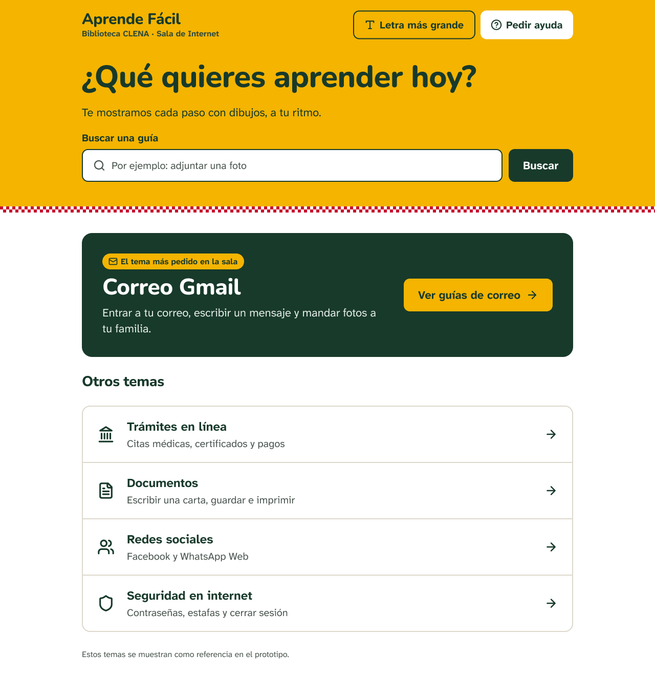

**HU-01 Guías de Correo Gmail**
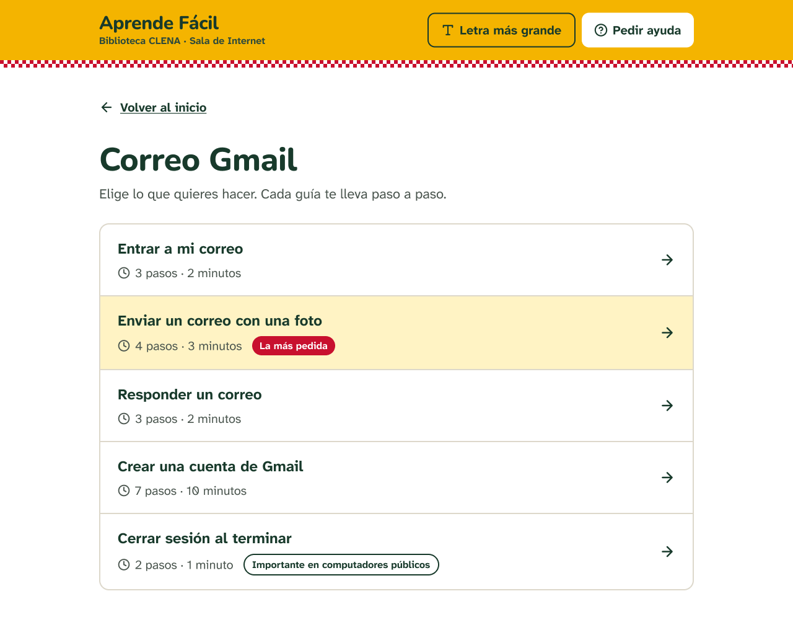

**HU-02 · HU-03 Guía paso 1 de 4 – Redactar**
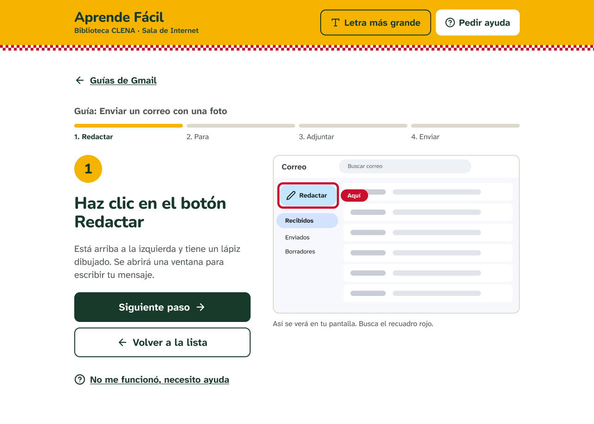

**HU-02 · HU-03 Guía paso 2 de 4 – Para**
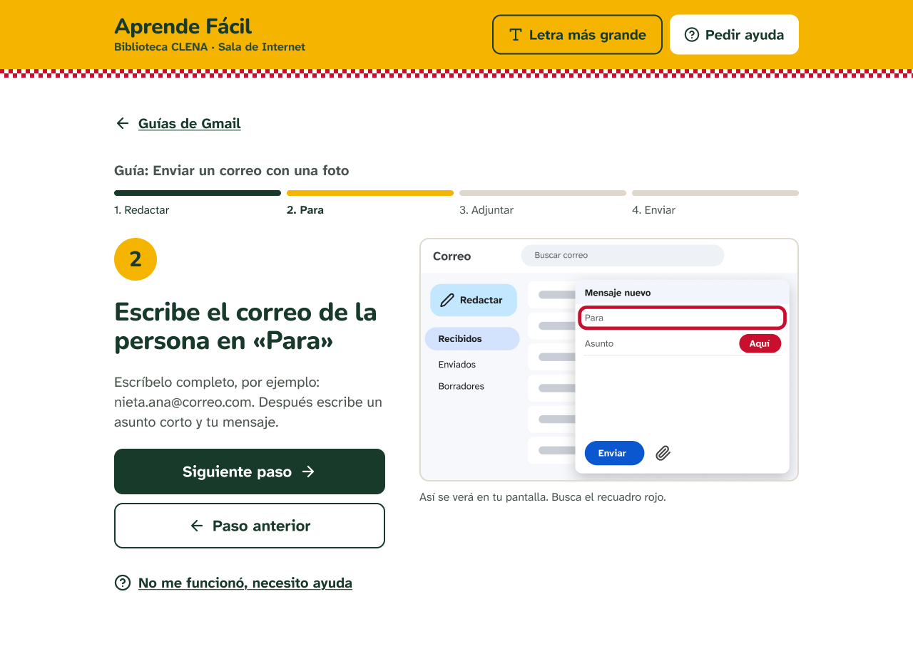

**HU-02 · HU-03 Guía paso 3 de 4 – Adjuntar**
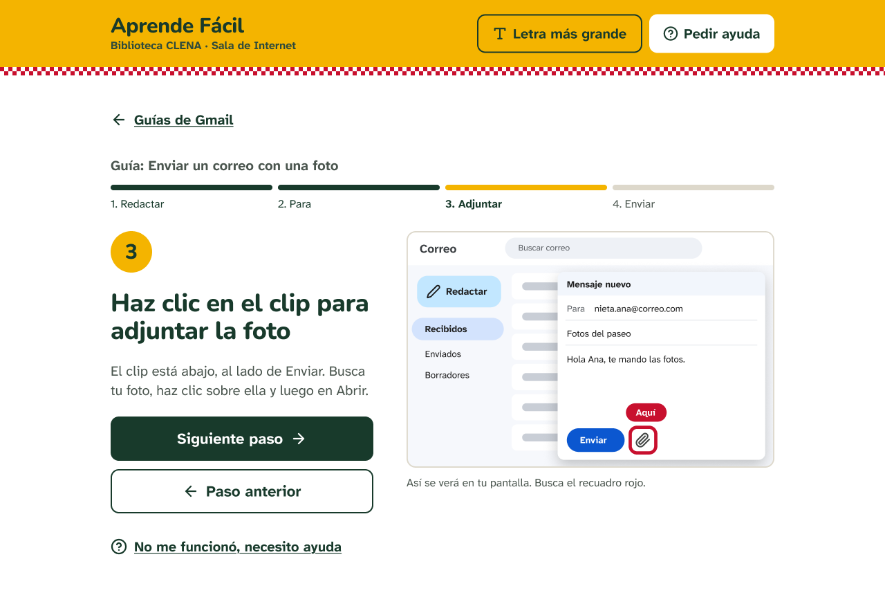

**HU-02 · HU-03 Guía paso 4 de 4 – Enviar**
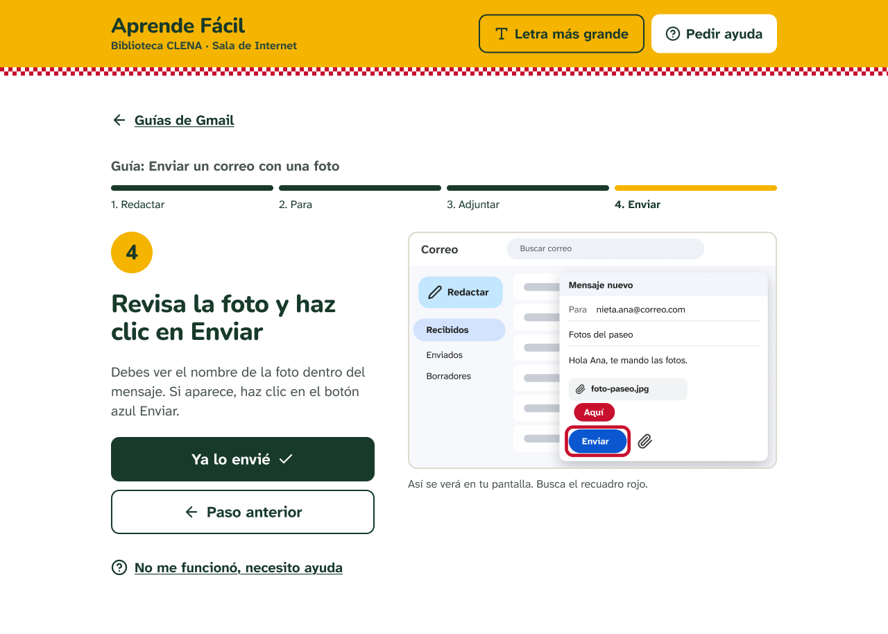

**HU-11 Guía terminada – ¿Te sirvió?**
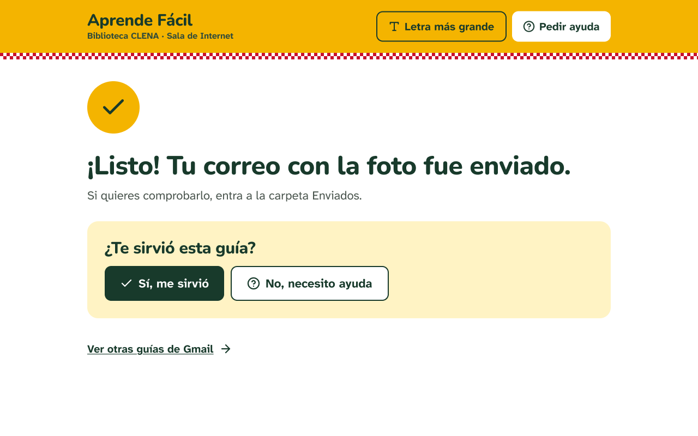

**HU-12 Pedir ayuda a la asistente**
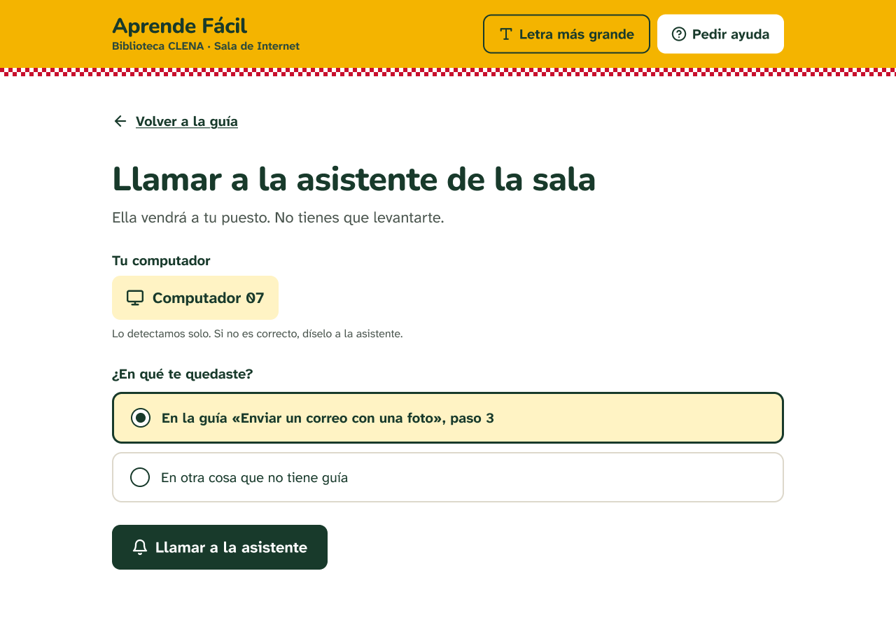

**HU-12 Ayuda solicitada**
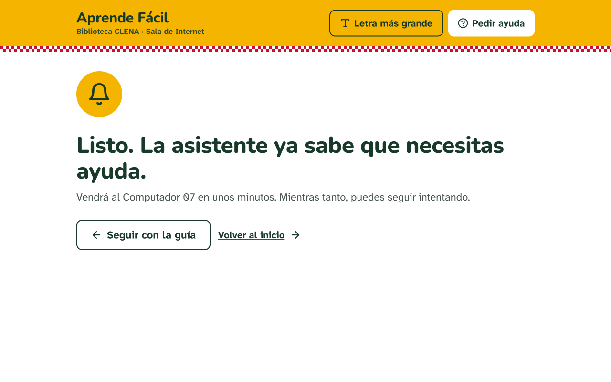

**HU-13 Panel de la asistente – Dudas sin guía**
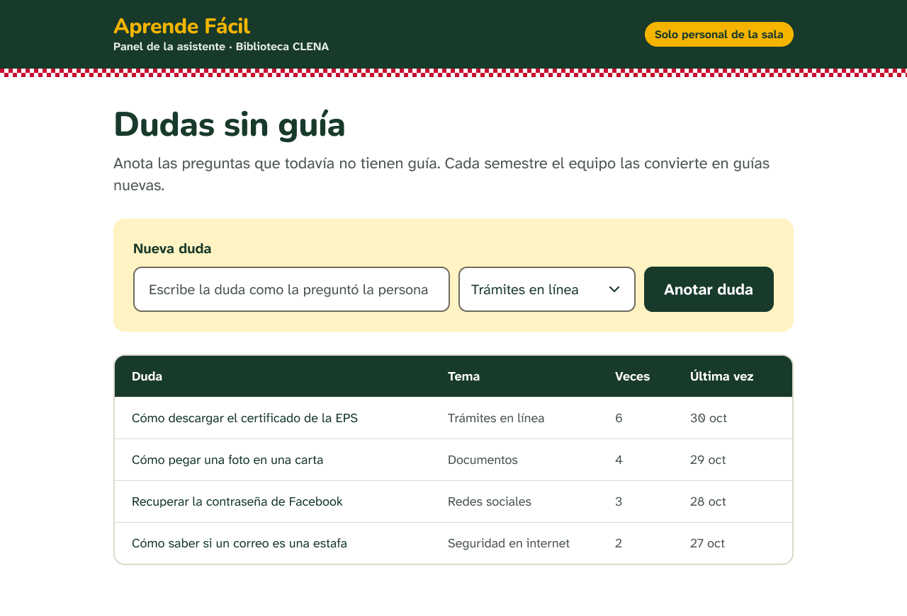

### Celular

**HU-01 · HU-04 · HU-10 Inicio – Elegir tema · Celular**
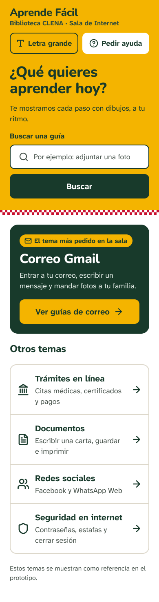

**HU-01 Guías de Correo Gmail · Celular**
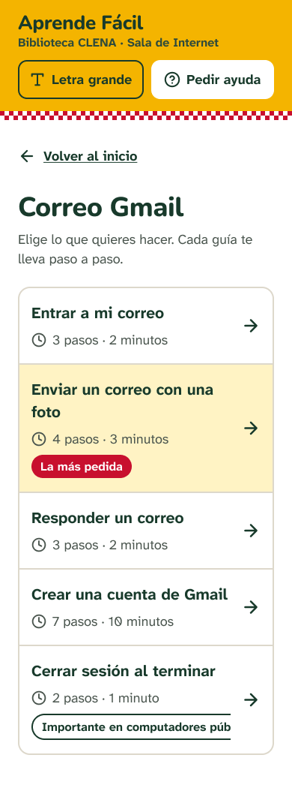

**HU-02 · HU-03 Guía pasos 1 a 4 · Celular**
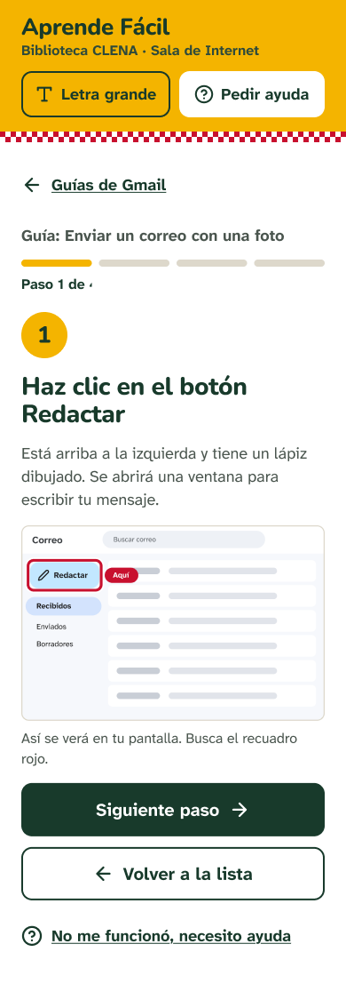
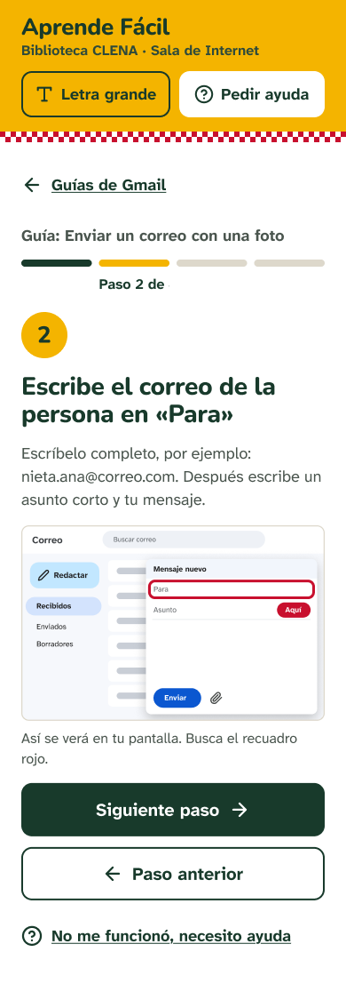
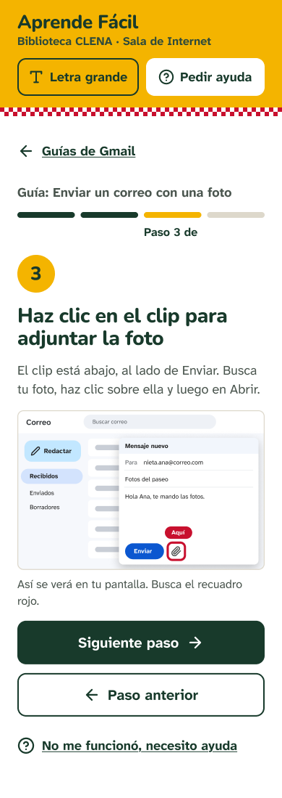
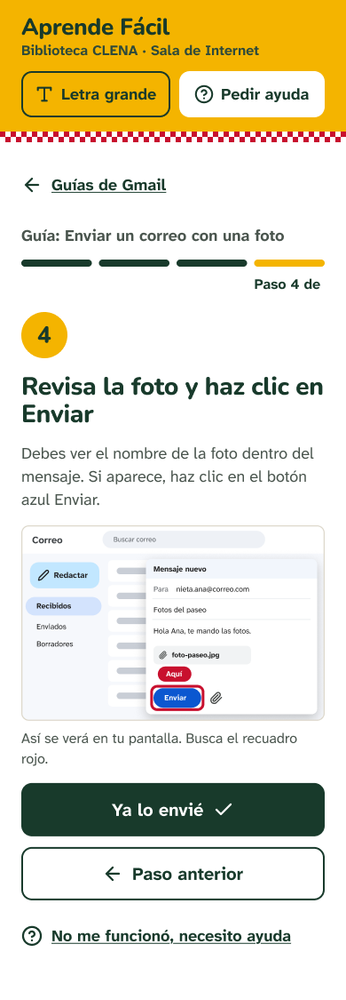

**HU-11 Guía terminada – ¿Te sirvió? · Celular**
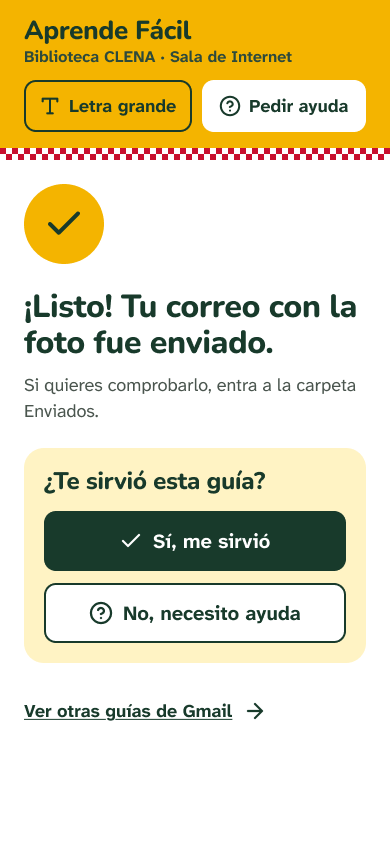

**HU-12 Pedir ayuda a la asistente · Celular**
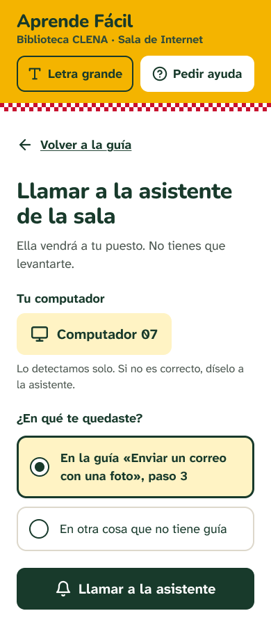

**HU-12 Ayuda solicitada · Celular**
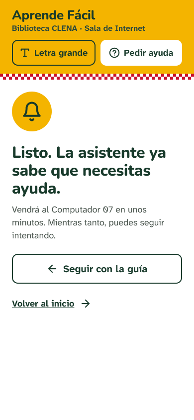

## Comparación con lo construido por Backend

_Pendiente: comparar una pantalla del prototipo con la que construyó el equipo de Backend y anotar las diferencias que deban corregirse._
